# 要旨

- **問い**:淡水食物網の構造は、緯度、気温、季節性(年間の気温変動の大きさ)とともにどう変わるか。それは種数の違いによるのか、それとも気候そのものの効果なのか。
- **データと方法**:IsoFresh の淡水食物網 606 件(止水・流水、熱帯から約 70°)を使った。δ13C・δ15N の近さから同位体類似度ネットワークを作り、混合モデルと piecewise SEM で解析した。測定サンプル数(サンプリング努力)は全モデルで調整した。
- **結果 1(パターン)**:極に近いほど、結合度、入れ子度、リンク強度が低かった(標準化効果 −0.2〜−0.3)。高緯度の食物網は、同位体的な重なりが小さく、まとまりに分かれた構造をしていた。止水・流水に共通で、サンプリング努力を調整しても変わらなかった。
- **結果 2(直接効果)**:結合度の低下の約半分は、種数を固定しても残る気候の直接効果だった。結合度は 1 ℃あたり +0.004 で上昇し、淡水魚の採餌特性から予測される向きと大きさ(Petchey et al. 2010)と一致した。温暖な水域ほど魚は雑食的だったが、これで説明できたのは直接効果の約 26% だった。
- **結果 3(間接効果)**:残りの半分と、入れ子度・リンク強度の低下の大部分は、高緯度で種数が少ないことを介していた。ただし種数はサンプリング努力に強く依存し、その影響を補正すると、種数を介した効果は約3分の1小さくなった。
- **結果 4(モジュラリティ)**:モジュラリティ(Q)は極ほど高かった。網の大きさの影響を除いた標準化モジュラリティ(z-Q)では全体の傾向が消えたが、これは種数を介した低下と、気候の直接の上昇が打ち消し合った結果だった。
- **結果 5(季節性)**:結合度への効果は気温の季節性が最も大きく(−0.31)、その約6割は直接効果だった。季節性は年平均気温とは独立に効いていた。
- **結論**:淡水食物網が極に近いほど疎になるのは、魚の採餌の温度依存性(直接の経路)と、種数の違い(間接の経路)の両方による。この結果は、高緯度の淡水食物網が温暖化によって、魚のジェネラリスト化と低緯度からの種の侵入を通じて結合度を増し、まとまりが崩れる方向に変わりうることを示す。温暖化の影響を予測するには、採餌特性だけでなく種構成の変化も組み込む必要がある。

# 1. 背景

温度は、消費者の採餌速度と群集の種数の両方を変える。Petchey, Brose & Rall (2010) は、採餌モデルに温度依存性を組み込み、結合度が温暖化で上がるか下がるかは、攻撃率と処理時間の温度感受性の大小で決まると予測した。ただし、このモデルは種構成を固定しており、自然の温度勾配での検証はされていない。一方、温度が種数などを介して間接的に食物網構造を変えることも報告されている(Gibert 2019;O'Gorman et al. 2019)。本解析では、緯度に沿った構造の違いを、気候の直接効果と群集を介した効果に分けて評価した。

本研究のリンクは捕食関係ではなく、同位体空間で近い分類群どうしを結んだものである。結合度は「同位体ニッチの重なりの度合い」を表し、雑食・ジェネラリストの消費者が多いほど高くなると考えられる。

# 2. 方法

**データ** IsoFresh データベース(淡水の食物網ごとの、魚類と魚類以外の δ13C・δ15N)を用いた。同じ分類群の値は食物網ごとに平均した。同位体が測定された分類群が 10 以上ある 606 食物網(止水 275、流水 331)を解析した。

**ネットワークの作り方** 食物網ごとに、分類群間の δ13C–δ15N 平面上のユークリッド距離を求め、その食物網の最大距離で割って類似度(1 − 距離/最大距離)とした。全食物網に共通の閾値(類似度 0.66;全食物網の類似度の平均)以上のペアをリンクとした。

- **結合度**:リンク数 ÷ 可能なリンク数 [S(S−1)/2]。S は分類群数。
- **入れ子度(z-NODF)**:重み付き NODF を、類似度をランダムに並べ替えたヌルモデル(199 回;分類群が 31〜50 の網では 100 回、51 以上では 50 回)で標準化した値。
- **リンク強度**:各分類群が持つ類似度の合計の平均。
- **モジュラリティ(Q)**:網がまとまり(モジュール)に分かれている度合い。rnetcarto で求めた。Q は分類群数やリンク密度によって変わるため、同じヌルモデルの Q と比べて標準化した値を **標準化モジュラリティ(z-Q)** とした。
- **餌ニッチ面積**:魚類以外の分類群が δ13C–δ15N 平面で作る凸包の面積。

**気候とサンプリング努力**

- **緯度**:絶対値(赤道からの距離)。
- **気温**:WorldClim 2.1(10 分角、約 1970〜2000 年の平年値)の年平均気温(BIO1)。
- **季節性**:WorldClim の気温の季節性(BIO4)。月平均気温 12 か月分の標準偏差(℃)で、夏と冬の気温差が大きいほど大きい。解析した食物網では 0.4〜15.9 ℃(中央値 4.6 ℃)で、熱帯で小さく、高緯度や大陸内部で大きい。
- **サンプリング努力**:IsoFresh の同位体データには、分類群ごとの平均値の計算に使われた測定数(N_Sample 列)が記録されている。これを食物網ごとに合計し、log10 変換した。多くは個体数だが、複数個体をまとめた混合サンプルの場合はサンプル数になる。N_Sample が記録されていない食物網(7%)は、SEM と感度解析から除いた。

**統計解析**

- **混合モデル**:各指標を各説明変数で説明し、地域と出典論文の入れ子のランダム効果 (1 | Region/Source_DOI) を入れた。変数は標準化し、多重検定は FDR(Benjamini–Hochberg 法)で補正した。止水と流水でも別に解析した。
- **piecewise SEM**:図3の構造(説明変数 → 種数 → 餌ニッチ面積 → 結合度・入れ子度・リンク強度、および説明変数からの直接経路)を、上と同じランダム効果を持つ混合モデルの連立として推定した(piecewiseSEM パッケージ)。サンプリング努力はすべての方程式に共変量として入れた。間接効果は経路係数の積、全体効果は直接効果と間接効果の和とした。説明変数は緯度、気温、季節性を一つずつ入れ替えた。
- **ブートストラップ媒介**:研究単位で 999 回リサンプリングし、種数と餌ニッチ面積を介した間接効果の 95% 信頼区間を求めた。
- **Petchey et al. (2010) との比較**:結合度の温度勾配(1 ℃あたり)を混合モデルで推定し、Rall et al. (2012) の活性化エネルギーから予測される向きと比べた。魚の栄養段階の高さは、(魚の δ15N の平均 − 他の分類群の δ15N の平均)÷ 3.4 とした。
- **ソフトウェア**:R 4.5.1(lme4 2.0.6、lmerTest 3.2.1、piecewiseSEM 2.3.1、rnetcarto 0.2.6、vegan 2.7.2)。Petchey らとの比較と魚の栄養段階の解析は R 4.4.2 で行った。

# 3. 結果

## 3.1 高緯度ほど結合度と種数が低い

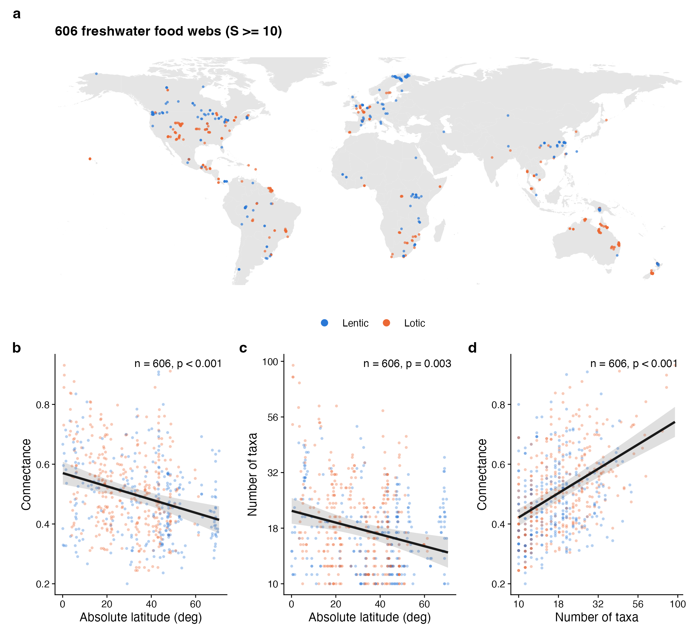{width=15cm}

**図1** (a)解析した 606 食物網(青:止水、橙:流水)。(b–d)直線と帯は混合モデルの推定値と95%信頼区間。

高緯度ほど結合度(P < 0.001)と分類群数(P = 0.003)が低い。分類群数が多いほど結合度は高いので、種数の効果を切り分ける必要がある。

## 3.2 気候の効果は一貫している

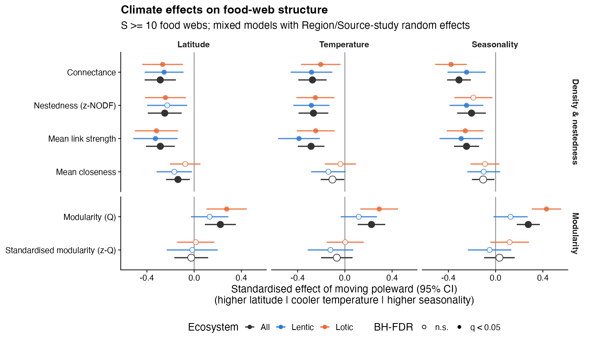{width=16cm}

**図2** 緯度、気温、季節性が6指標に与える標準化効果と95%信頼区間。季節性は月平均気温の標準偏差(夏と冬の気温差の大きさ;WorldClim BIO4)。3つの説明変数は「極に近づく向き」にそろえてある:緯度は高いほう、気温は低いほう、季節性は大きいほうが正。黒は全食物網、青は止水、橙は流水。塗りつぶしは FDR 補正後 q < 0.05。

極に近づくほど、結合度(−0.27〜−0.31)、入れ子度(−0.20〜−0.27)、リンク強度(−0.25〜−0.29)が低下する。測定サンプル数を調整しても、個体数の多い網だけに絞っても、リンク閾値を変えても結論は同じである(図S1、S5)。

## 3.3 直接効果と、種数を介した効果

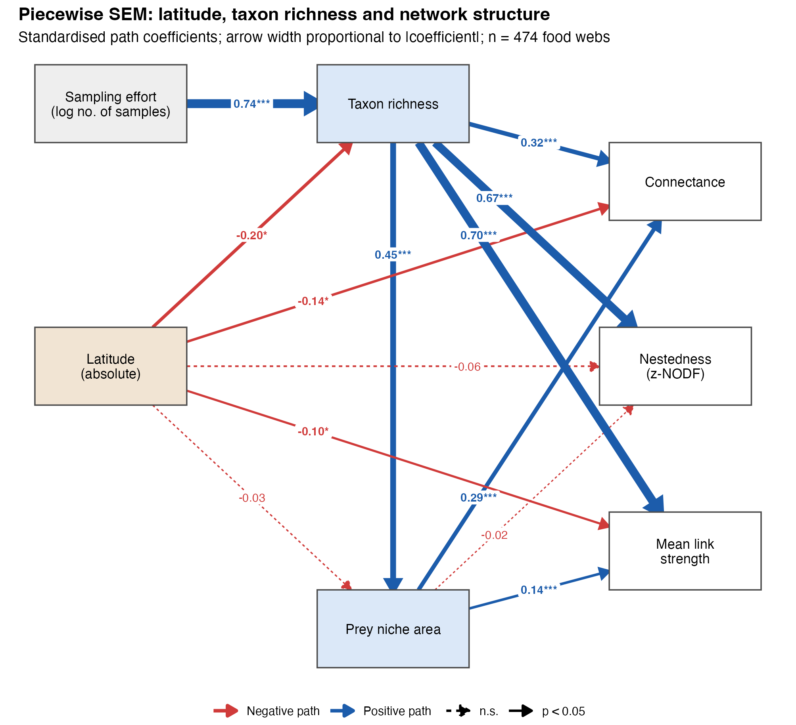{width=15cm}

**図3** piecewise SEM の経路図(説明変数が緯度のモデル、n = 474)。数値は標準化経路係数で、矢印の太さは係数の大きさに比例する。青は正、赤は負の経路、点線は有意でない経路(P ≥ 0.05)。* P < 0.05、** P < 0.01、*** P < 0.001。サンプリング努力はすべての応答変数に共変量として入れたが、図では種数への経路だけを示した(ほかの経路は −0.09〜0.08)。説明変数を気温または季節性に替えた同じ構造のモデルは、図S10、図S11に示した。

緯度は種数を減らし(−0.20)、種数は結合度(0.32)、入れ子度(0.67)、リンク強度(0.70)を強く高める。種数は餌ニッチ面積も広げ(0.45)、餌ニッチ面積は結合度(0.29)とリンク強度(0.14)を高める。緯度から結合度(−0.14)とリンク強度(−0.10)への直接の経路も有意だが、入れ子度への直接経路は有意でない(−0.06)。

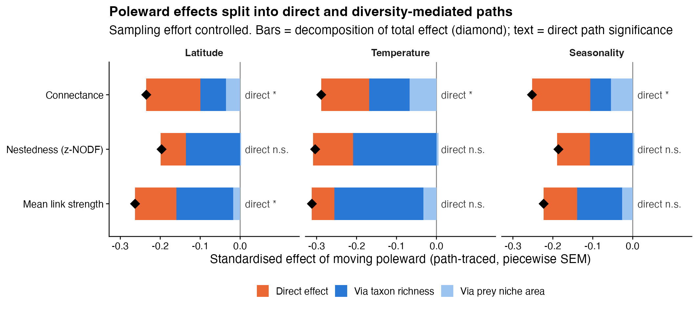{width=16cm}

**図4** 図3と同じ構造の SEM から求めた効果の分解。説明変数を緯度、気温、季節性(月平均気温の標準偏差)に入れ替えた3つのモデルの結果を並べた。値は極に近づく向きにそろえてある(気温は低いほう、季節性は大きいほうが正)。棒は直接効果(橙)、種数を介した効果(青)、餌ニッチ面積を介した効果(水色)。ひし形は全体の効果。右の文字は、直接効果が有意(*)かどうか。

結合度には、種数を固定しても気候の直接効果が残る(緯度 −0.14、P = 0.027;全体 −0.24 の約 57%)。入れ子度は主に種数を介して低下し(約7割)、直接効果は有意でない。リンク強度はその中間である。ブートストラップ媒介分析でも、種数を介した効果は有意だった(図S2)。

## 3.4 直接効果の中身:魚の採餌と雑食性

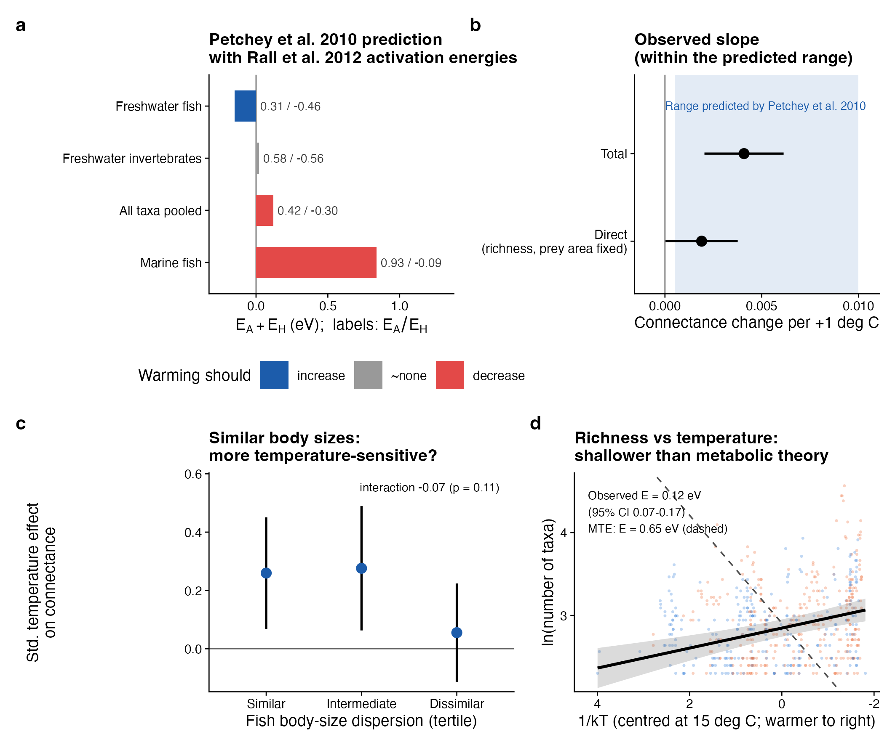{width=16cm}

**図5** (a)淡水魚などの活性化エネルギー(Rall et al. 2012)から、Petchey et al. (2010) のモデルが予測する温暖化の効果の向き。(b)観測された結合度の温度勾配と、予測された範囲(青い帯)。(c)魚の体サイズのばらつき別の温度効果。(d)種数と温度(アレニウス・プロット)。

- 淡水魚は、攻撃率(0.31 eV)より処理時間(−0.46 eV)のほうが温度に敏感である。そのため、温暖ほど探索型のジェネラリストになり、結合度が上がると予測される。観測(1 ℃あたり +0.004、直接効果のみでは +0.002)は、この向きと大きさの範囲に一致した。
- 温暖な水域ほど、魚の栄養段階は他の分類群に比べて低かった(雑食化、P = 0.048)。栄養段階が低いほど結合度は高かった(P < 0.001)。魚の栄養段階を考慮すると、気温の直接効果は約 26% 小さくなった(図S8)。
- 体サイズが似た食物網ほど温度に敏感という予測は、方向は一致したが有意ではなかった(P = 0.11)。種数の温度依存性(0.12 eV)は、代謝理論の予測(0.65 eV)よりずっと小さかった。

## 3.5 モジュラリティ

モジュラリティ(Q)は極ほど高く、北極の海洋食物網での報告(Kortsch et al. 2015)と同じ向きだった。標準化モジュラリティ(z-Q)では全体の傾向が 0 に近い。種数を介した低下(緯度で −0.14)と、気候の直接の上昇(+0.14)が打ち消し合うためである。

# 4. 考察

**考察の要点**

1. **パターン**:極に近いほど、淡水食物網は同位体的な重なりが小さく、いくつかのまとまりに分かれた構造になる。止水と流水に共通し、北極の海洋食物網(Kortsch et al. 2015)と同じ向きである。
2. **直接効果(魚の採餌)**:結合度の低下の約半分は、種数を固定しても残る気候の直接効果である。淡水魚は処理時間のほうが温度に敏感なので、温暖な水域ほどジェネラリスト・雑食的になる(Petchey et al. 2010 の予測と一致)。ただし、魚の栄養段階で説明できたのは直接効果の約 26% にとどまる。
3. **間接効果(種数)**:残り半分は、高緯度で種数が少ないことを介した効果である。種数はサンプリング努力に強く依存し、その影響を補正すると種数経由の効果は約3分の1小さくなる。
4. **モジュラリティ**:標準化モジュラリティ(z-Q)で傾向が消えるのは、効果がないからではない。種数を介した低下と、気候の直接の上昇が打ち消し合った結果である。
5. **季節性**:結合度への効果は3つの説明変数で最大で、その約6割が直接効果だった。年平均気温とは独立に効いており、季節ごとに資源の使い方が変わることが一因と考えられる。
6. **温暖化への示唆**:高緯度の淡水食物網は、温暖化で結合度が上がり、まとまりが崩れる方向に変わりうる。経路は、採餌のジェネラリスト化と種の侵入の2つで、予測には種構成の変化も組み込む必要がある。

## 4.1 極に近いほど、淡水食物網は疎で分かれた構造になる

極に近いほど、結合度、入れ子度、リンク強度がそろって低下し、モジュラリティ(Q)は上がった。高緯度の淡水食物網は、分類群どうしの同位体的な重なりが小さく、いくつかのまとまりに分かれた構造をしている。この傾向は止水と流水に共通し、サンプリング努力やリンクの閾値を変えても変わらなかった。北極の海洋食物網でも、北方の食物網より結合度が低くモジュール性が高いことが報告されており(Kortsch et al. 2015)、高緯度の食物網に共通する性質である可能性がある。一方、196 の捕食網を調べた Cirtwill et al. (2015) は、湖では極に近いほど種あたりのリンク数が多くなると報告しており、本研究とは逆向きである。同位体の重なりと捕食関係の違いが一因と考えられ、両者を同じデータで比べることが今後の課題になる。

## 4.2 直接効果:魚の採餌と雑食性

種数を固定しても、結合度には気候の直接効果が残った(緯度で全体の約半分)。この直接効果の向きと大きさは、Petchey et al. (2010) の採餌モデルの予測と一致した。淡水魚では、攻撃率より処理時間のほうが温度に敏感である(Rall et al. 2012)。そのため温暖な水域では、魚は餌を処理する時間が相対的に短くなり、多くの種類の餌を食べる「探索型」のジェネラリストになると予測される。実際に、温暖な水域ほど魚の栄養段階は他の分類群に比べて低く、雑食的だった。低緯度ほど魚の雑食性が高いというメタ解析の結果(González-Bergonzoni et al. 2012)とも整合する。

ただし、魚の栄養段階で説明できたのは、気温の直接効果の約 26% にとどまった。残りには、餌生物の量や体サイズの違い、測定していない採餌特性が関わっていると考えられる。また、活性化エネルギーは文献値を借りており、IsoFresh の種で測ったものではない。この経路をより直接に確かめるには、胃内容物や DNA メタバーコーディングで、温度勾配に沿った餌メニュー幅を測る必要がある。

## 4.3 間接効果:種数とサンプリング努力

結合度の低下の残り半分と、入れ子度やリンク強度の低下の大部分は、高緯度で分類群数が少ないことを介していた。気温が種数などを通じて間接的に食物網構造を変えるという報告(Gibert 2019)や、地熱河川の温暖化で消費者と資源の構成が変わり食物網が単純化したという報告(O'Gorman et al. 2019)と合致する。

ただし、本研究の種数は「同位体が測定された分類群の数」であり、サンプリング努力に強く依存していた(SEM の経路係数 0.74)。サンプリング努力を調整すると、種数を介した効果は約3分の1小さくなった。つまり、種数経由の効果の一部は、研究ごとの測定の多さを反映している可能性がある。それでも緯度から種数への効果は有意に残り、直接効果はほとんど変わらなかった。種数経由の効果の大きさは控えめに解釈すべきだが、結論の方向は変わらない。

## 4.4 モジュラリティ:見かけの増加か、本当の増加か

モジュラリティ(Q)は極ほど高かったが、網の大きさの影響を除いた標準化モジュラリティ(z-Q)では、全体の傾向が消えた。SEM で分けてみると、これは「効果がない」のではなく、二つの逆向きの効果が打ち消し合った結果だった。高緯度では種数が少ないため z-Q が下がる一方、気候の直接効果は z-Q を上げる方向に働いていた(緯度 +0.14、季節性 +0.17)。高緯度の食物網がまとまりに分かれる傾向は、種数の違いを除いても残っていると考えられる。

## 4.5 季節性の独立した役割

3つの説明変数のうち、結合度への効果が最も大きかったのは気温の季節性だった(−0.31)。季節性から種数への効果は弱く有意でなかった(−0.16、P = 0.058)。結合度への全体効果のうち約6割は直接効果だった。気温と季節性の交互作用は有意でなく(FDR 補正後の最小 q = 0.38)、二つの効果はおおむね独立して加わる。夏と冬の差が大きい環境では、消費者が季節ごとに異なる資源を使い、食物網が時間軸に沿って組み替わることが指摘されている(McMeans et al. 2015)。同位体は数週間から数か月の食性を平均するので、季節的に分かれた資源利用が、同位体ニッチの重なりの小ささとして現れたのかもしれない。年平均気温だけでなく、季節変動の大きさも食物網構造の重要な決定要因だと考えられる。

## 4.6 温暖化への示唆

空間の勾配から時間変化を推測するには注意が必要だが(Blois et al. 2013)、本研究の結果は、高緯度の淡水食物網が温暖化で結合度を増し、まとまりが崩れる方向に変わる可能性を示す。その経路は二つある。魚の採餌がジェネラリスト化する直接の経路と、低緯度からの種の侵入で群集が変わる間接の経路である。北極海で北方のジェネラリスト魚の進出が食物網を変えている例(Kortsch et al. 2015)は、後者の経路が実際に働きうることを示している。採餌特性だけを扱うモデルでは観測された勾配の半分程度しか説明できないので、温暖化の影響の予測には、種構成の変化を組み込んだモデルが必要である。

# 5. 注意点

- 同位体類似度ネットワークは捕食関係そのものではなく、餌の重なりの代理指標である。
- 気候値は長期平均で、サンプリング時期と一致しない。そのため緯度を主な指標とした。
- 種数は同位体を測定した分類群の数で、サンプリング努力と分類の粒度の影響を受ける。
- 活性化エネルギーは文献値(Rall et al. 2012)であり、IsoFresh の種で測ったものではない。
- 相関に基づく解析であり、因果は断定できない。

# 補足図

補足図の「Seasonality」は、すべて月平均気温の標準偏差(夏と冬の気温差の大きさ)を指す。「Temperature」は年平均気温である。

## 図S1 リンク閾値への頑健性

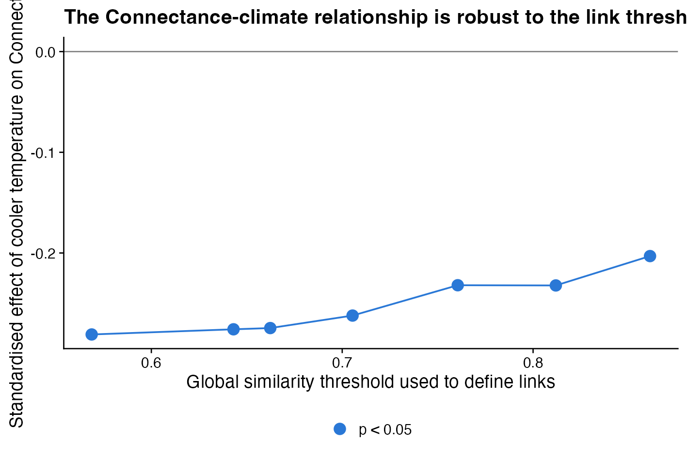{width=10cm}

## 図S2 ブートストラップ媒介分析

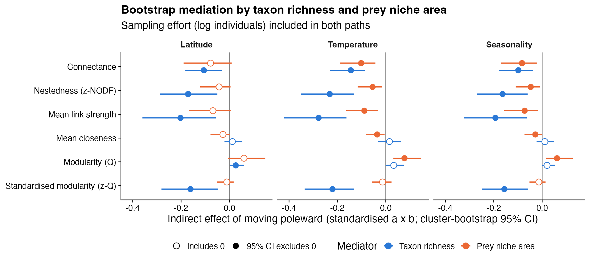{width=16cm}

## 図S3 全変数と全指標

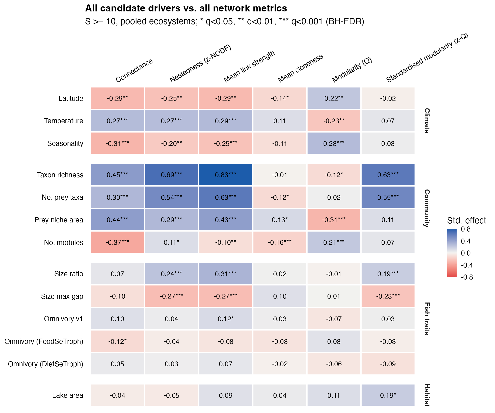{width=15cm}

## 図S4 交互作用

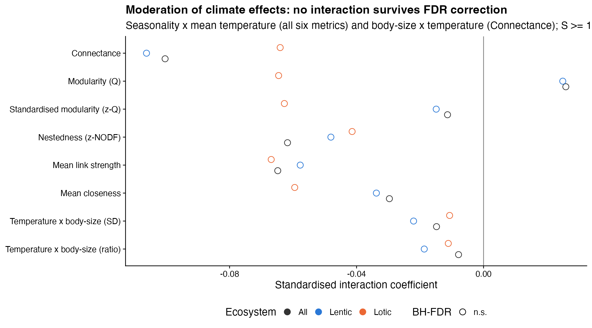{width=16cm}

## 図S5 サンプリング努力

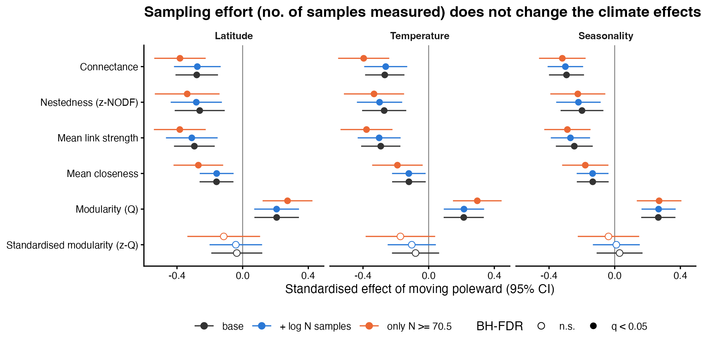{width=16cm}

## 図S6 SEM:サンプリング努力の有無

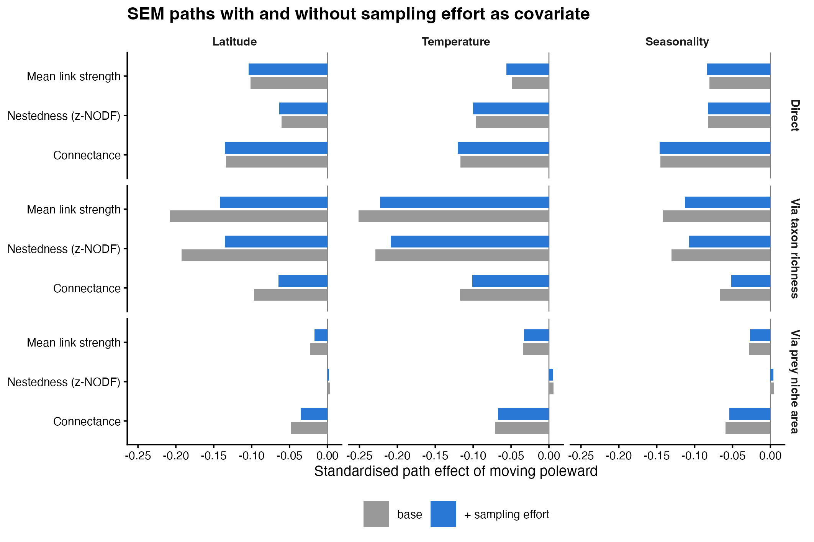{width=15cm}

## 図S7 SEM の経路係数(緯度モデル)

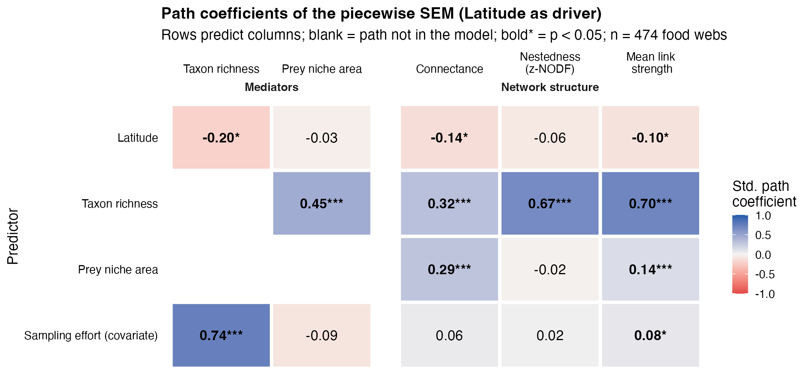{width=16cm}

## 図S8 魚の雑食性と結合度

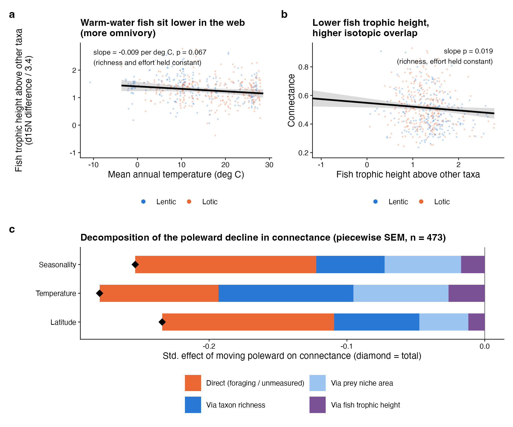{width=16cm}

## 図S9 同位体ニッチの形と種数

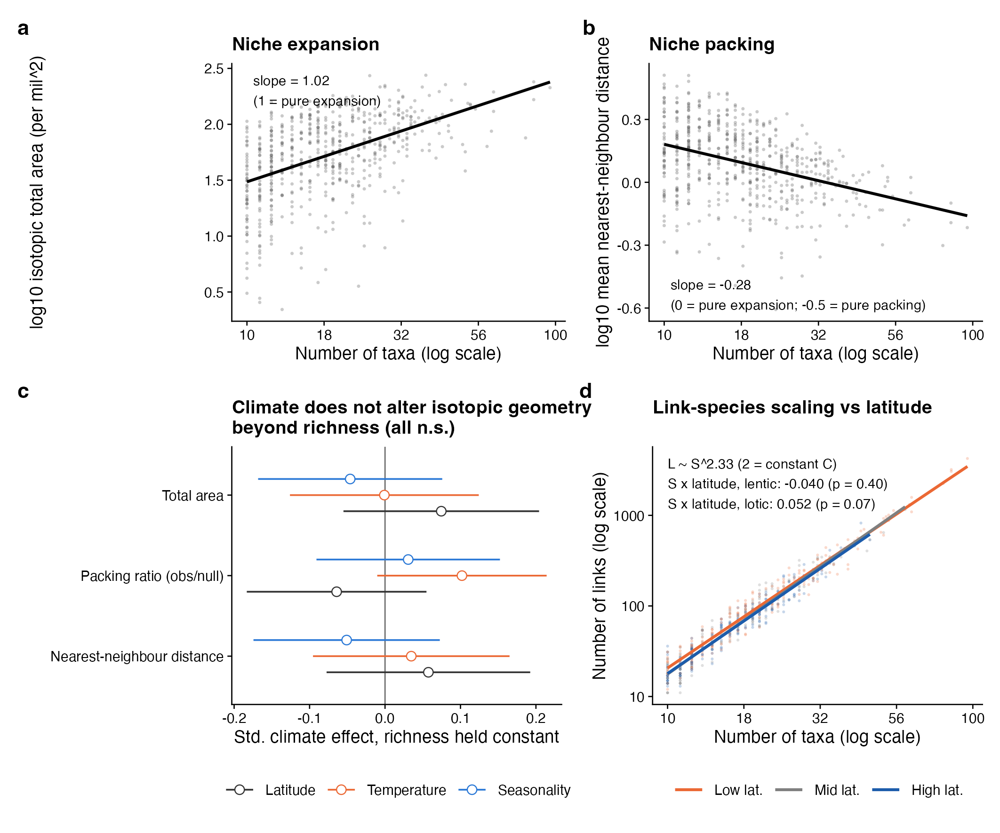{width=16cm}

種数が増えると、同位体空間は主に広がり(拡大)、部分的に密になる(充填)。種数を固定すると、気候はニッチの形を変えない。

## 図S10 SEM の経路図(説明変数が年平均気温)

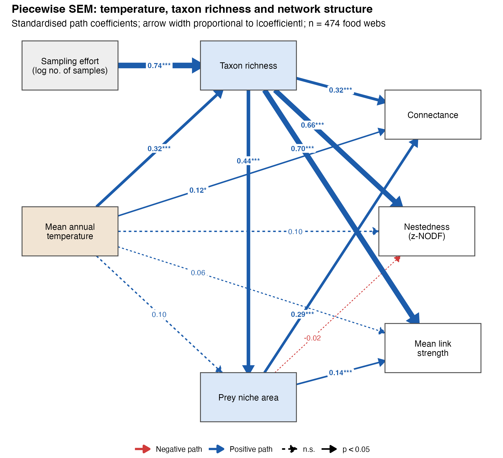{width=15cm}

図3と同じ構造で、説明変数を年平均気温にしたモデル(n = 474)。ここでは極に近づく向きにそろえていないので、正の係数は「温暖ほど大きい」を意味する。気温は種数を増やし(0.32)、結合度を直接高める(0.12)。入れ子度とリンク強度への直接経路は有意でない。

## 図S11 SEM の経路図(説明変数が気温の季節性)

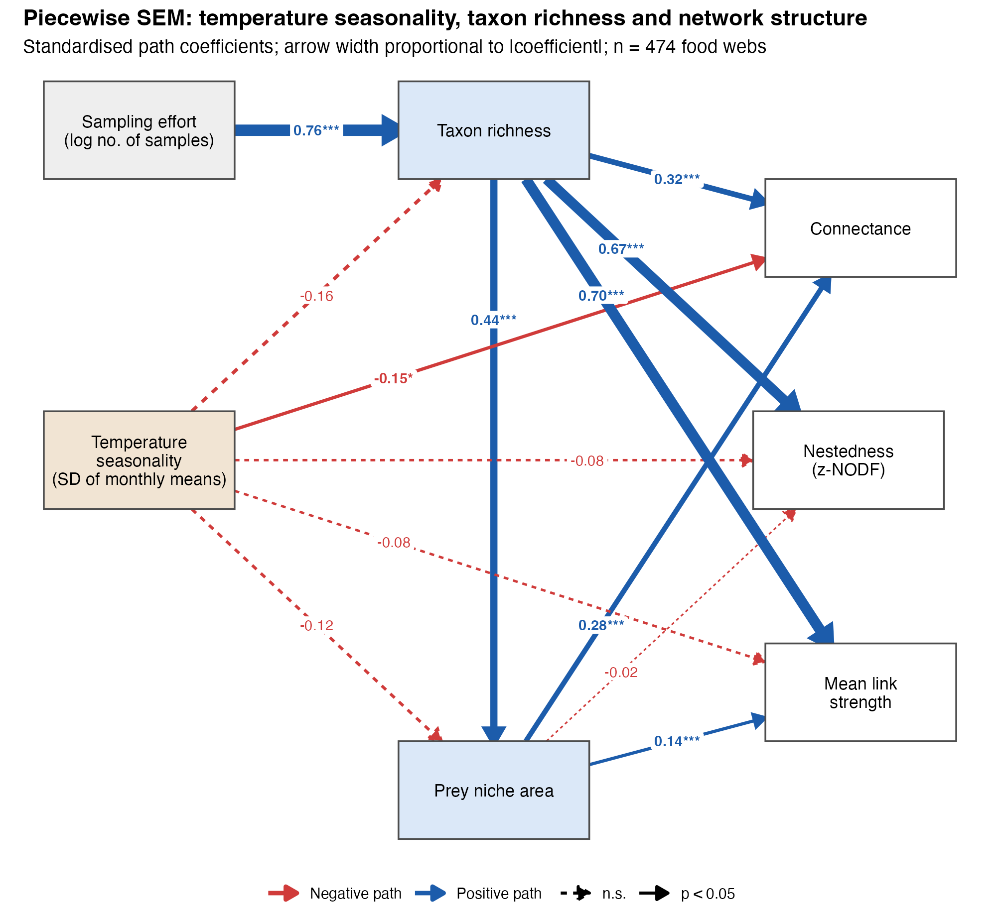{width=15cm}

説明変数を気温の季節性(月平均気温の標準偏差;夏と冬の気温差の大きさ)にしたモデル(n = 474)。季節性が大きいほど結合度は直接低下する(−0.15)。種数への経路は負だが有意でない(−0.16、P = 0.058)。

# 文献

- Blois JL, Williams JW, Fitzpatrick MC, Jackson ST, Ferrier S (2013) Space can substitute for time in predicting climate-change effects on biodiversity. *PNAS* 110: 9374–9379.
- Cirtwill AR, Stouffer DB, Romanuk TN (2015) Latitudinal gradients in biotic niche breadth vary across ecosystem types. *Proc R Soc B* 282: 20151589.
- Fick SE, Hijmans RJ (2017) WorldClim 2: new 1-km spatial resolution climate surfaces for global land areas. *Int J Climatol* 37: 4302–4315.
- Gibert JP (2019) Temperature directly and indirectly influences food web structure. *Sci Rep* 9: 5312.
- González-Bergonzoni I, Meerhoff M, Davidson TA, Teixeira-de Mello F, Baattrup-Pedersen A, Jeppesen E (2012) Meta-analysis shows a consistent and strong latitudinal pattern in fish omnivory across ecosystems. *Ecosystems* 15: 492–503.(著者・巻・頁は要確認)
- Kortsch S, Primicerio R, Fossheim M, Dolgov AV, Aschan M (2015) Climate change alters the structure of arctic marine food webs due to poleward shifts of boreal generalists. *Proc R Soc B* 282: 20151546.
- Lefcheck JS (2016) piecewiseSEM: piecewise structural equation modelling in R for ecology, evolution, and systematics. *Methods Ecol Evol* 7: 573–579.
- McMeans BC, McCann KS, Humphries M, Rooney N, Fisk AT (2015) Food web structure in temporally-forced ecosystems. *Trends Ecol Evol* 30: 662–672.
- O'Gorman EJ et al. (2019) A simple model predicts how warming simplifies wild food webs. *Nat Clim Change* 9: 611–616.
- Petchey OL, Brose U, Rall BC (2010) Predicting the effects of temperature on food web connectance. *Phil Trans R Soc B* 365: 2081–2091.
- Rall BC et al. (2012) Universal temperature and body-mass scaling of feeding rates. *Phil Trans R Soc B* 367: 2923–2934.
